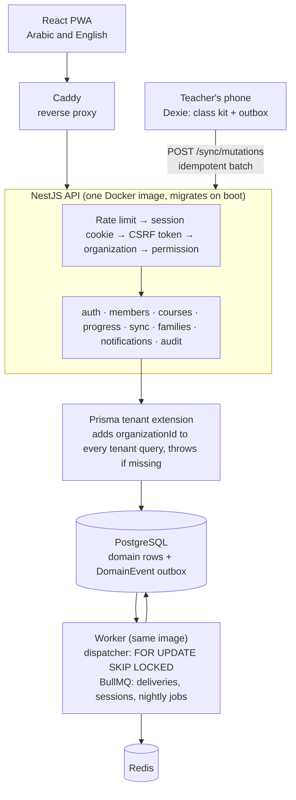

# Ribat

Multi-tenant management system for all the teaching in a mosque: Quran memorization circles and
lessons in any subject, members and their families, teachers, schedules set by the clock or by
prayer times, attendance and progress that teachers record **offline** in class, a family portal,
in-app notifications, and a full audit trail. Installable PWA in Arabic (RTL) and English.

[](https://github.com/Salad-man3/ribat/actions/workflows/ci.yml)

<p align="center">
  <strong>▶ <a href="https://salad-man3.github.io/#ribat">Watch the five-minute tour</a></strong>
  <br/><em>English narration, Arabic subtitles: the sheikh, a teacher whose phone goes offline mid-class, a student and his father.</em>
</p>

## What it does

### For the mosque's staff (sheikh and admins)

- **Overview.** Every tool the signed-in role is allowed to use, nothing else.
- **Members, in Arabic.** Search and filter by status; the whole UI flips to right-to-left.
- **A member.** Guardians, siblings in the same household, education (school, university, or highest
  qualification), private staff notes with their own visibility, and app access issued with a
  one-time setup code.
- **Courses (حلقات).** Memorization, explanation or both. One teacher for everyone, or a lead
  teacher with assistants and the students split into groups, each teacher seeing only his own.
  Draft, active, paused, finished and archived, with the lifecycle enforced by the API.
- **Schedule.** Classes start and end at a fixed time or at a prayer ("from Asr to Maghrib");
  holidays pause them, and the next four weeks of sessions are generated.
- **Prayer times.** Look up the city, then correct any prayer to match the mosque's own adhan; the
  offset is kept for every day.
- **Materials.** The Quran (604 pages) and the texts (mutun) and books the mosque teaches.
- **Homework.** For the whole course, one group or one student; tracked to done, and marked missed
  by a nightly job.
- **Excuses.** Families ask before or after an absence; accepting one turns the matching absences
  into "excused", including marks taken later.
- **Audit log.** Every login and every change to people, roles and courses, with who did it and the
  request it came from.
- **Failed events.** Reactions run on a transactional outbox; one that keeps failing becomes a
  visible dead letter with a retry button.
- **OpenAPI.** Swagger UI for every endpoint, behind `API_DOCS=true`.

### For teachers — class mode, offline

- **Today.** The class kit (sessions, the teacher's own students, each one's last position) is
  cached on the phone, with the class happening now and the next one marked.
- **No internet.** One tap per student; changes wait in IndexedDB with an idempotency key made at the
  tap, and a tally shows who is left.
- **Recitation.** New memorization, revision or a test; surah and ayah range → mushaf pages, checked
  offline against the Quran dataset. Explanation lessons log the pages covered.

### For members and families

- **Family portal.** Each child's week in Hijri and Gregorian dates, attendance rate, memorization,
  tests, homework and excuses — only their own children, enforced by the API.
- **Notifications.** Test results, homework, cancelled classes and a nightly absence summary, stored
  as translation keys so each reader gets their own language.
- **Themes.** Six palettes drawn from the Prophet's Mosque, Iznik tiles, the Alhambra, the mushaf page
  and the night prayer, with a girih pattern.

## How it is built



- **Offline class mode that cannot double-count.** The teacher's phone keeps a class kit and an
  outbox in IndexedDB. Each tap gets an idempotency key once; the server replays a batch in
  per-student lanes, authorises every mutation with the teacher's permissions *at replay time*,
  and records it in the same transaction as the write and its audit row. Attendance conflicts
  resolve last-writer-wins by class time, with the loser kept in the audit log.
- **Memorization as a ledger.** Logs are append-only ayah ranges; mistakes are voided with a
  reason, never edited. A derived summary per student is rewritten in the same transaction and
  can be rebuilt from the ledger at any time.
- **Transactional outbox.** Domain events commit with the change; a `SKIP LOCKED` dispatcher fans
  them out to BullMQ; handlers are idempotent per event and end as visible dead letters after
  five failures.

- **Tenant isolation in one place.** Many mosques share one schema. A Prisma client
  extension injects `organizationId` into every query on a tenant table and throws if a
  query reaches one without it. The e2e suite runs against two organizations and checks that
  the other one's records come back as 404.
- **Accounts without email.** Staff create people; a one-time setup code (hashed, 7 days,
  single use) lets the person choose their own password, hashed with Argon2id. Login and
  setup are rate-limited per IP.
- **Revocable cookie sessions.** Sessions live in the database, so signing a device out or
  changing a password ends access immediately. Every unsafe request carries a CSRF token
  bound to the session.
- **Roles shape responses, not just routes.** Sheikh, admin, member and guardian get
  different fields from the same member endpoint; private notes never leave the server for
  roles that may not see them.
- **Audit everything that matters.** An append-only log records the actor, the change and
  the request ID, which also appears on every Pino log line for that request.
- **Shared contracts.** Request and response schemas are Zod, in `packages/shared`, used by
  both the API and the PWA.

## Stack

| Layer | Choice | What it does here |
| --- | --- | --- |
| API | NestJS 11, TypeScript, Prisma 6, PostgreSQL 16, Redis 7, BullMQ | HTTP API, tenant-scoped persistence, background jobs and the event outbox |
| Web | React 19, Vite 6, Tailwind CSS 4, React Router | UI, routing, and styling |
| Web (server state) | TanStack Query | Caches and refreshes online API data after mutations; not used for offline class mode |
| Web (i18n) | i18next | Arabic and English UI; notifications use translation keys so each reader gets their language |
| Web (offline) | Dexie | IndexedDB store for the teacher's class kit and sync outbox on the phone |
| Web (installable) | Workbox PWA | Service worker that caches the app shell so class mode opens without network |
| Shared | Zod (`packages/shared`), Quran data (`packages/quran-data`) | One schema for API and PWA; offline mushaf page lookup |
| Prayer times | `adhan`, Aladhan city lookup, per-prayer mosque offsets | Schedule classes anchored to adhan times |
| Monorepo | pnpm workspaces, Turborepo | One repo, shared packages, cached builds |
| Quality | Oxlint, Prettier, `tsc --noEmit`, Jest, Vitest, Supertest e2e | Lint, format, typecheck, unit and integration tests |
| Deploy | One Docker image (API + built PWA), worker from same image, Caddy | **Caddy** is the public entry: HTTPS and reverse proxy to the API. The API serves the built PWA too, so the browser has one origin — session cookies stay first-party and CORS is not needed |

## Quick start

### Try it (Docker only)

Works on Windows, macOS, and Linux. Node and pnpm are not required.

```bash
docker compose -f deploy/compose.demo.yml up -d --build
docker compose -f deploy/compose.demo.yml run --rm seed
```

Open http://localhost:3000. Use the demo accounts below (`demo-ribat-2026`).

### Develop (Node + Docker for Postgres and Redis)

**Prerequisites:** Node 20+, pnpm 12.4.2 (`corepack enable`), Docker.

```bash
pnpm install
cp .env.example .env
cp .env.example apps/api/.env      # the Prisma CLI reads apps/api/.env
docker compose -f deploy/compose.dev.yml up -d
pnpm db:migrate
pnpm db:seed                       # wipes and recreates the demo data
pnpm dev
```

- PWA: http://localhost:5173 — class mode at `/teach`
- API: http://localhost:3000/api/v1/health/live
- API docs: http://localhost:3000/api/docs (with `API_DOCS=true`)

Postgres is on **5435** and Redis on **16379** on the host so they do not clash with other local
services.

See [CONTRIBUTING.md](./CONTRIBUTING.md) for the full contributor workflow.

### Demo accounts

All demo accounts use the password `demo-ribat-2026`. The data is fictional: مسجد النور has
100 members with Arabic names, 10 circles and lessons, 10 materials, and four weeks of
attendance, recitations and lesson pages, so every screen has something to show.

| Phone | Role | Sees |
| --- | --- | --- |
| `+963999001001` | Sheikh | Everything in مسجد النور, including private notes |
| `+963999001010` | Admin | Members, courses and settings |
| `+963999001030` | Member, teacher | Their portal, the two circles they teach, and class mode at `/teach` |
| `+963999001101`…`109` | Member, teacher | One circle or lesson each |
| `+963999001050` | Guardian | Their own child only |
| `+963999001201`…`224` | Guardian | Their own children only |
| `+963999002001` | Sheikh, isolation test mosque | Nothing from مسجد النور |

### Import members from CSV

```bash
pnpm --filter api import:members --file=members.csv --org=demo-mosque
```

The import validates every row first and writes nothing if any row fails.

## Commands

| Command | Does |
| --- | --- |
| `pnpm dev` | API (:3000) and PWA (:5173) with reload |
| `pnpm build` | Production build of all packages |
| `pnpm lint` | Oxlint across the monorepo |
| `pnpm typecheck` | TypeScript check of all packages |
| `pnpm test` | Unit tests (API, web, shared) |
| `pnpm test:e2e` | API integration tests against real Postgres and Redis |
| `pnpm db:migrate` | Apply Prisma migrations |
| `pnpm db:seed` | Reset the demo data |
| `pnpm db:studio` | Open Prisma Studio |
| `pnpm --filter api projections:rebuild` | Rebuild memorization summaries from the ledger |

CI runs lint, typecheck, unit tests, e2e tests and the build on every push.

## Production

```bash
SESSION_SECRET=$(openssl rand -hex 32) docker compose -f deploy/compose.prod.yml up -d --build
```

One image serves the API and the built PWA and runs migrations on boot; a second container
from the same image consumes the job queue; Caddy sits in front on port 80. Put a domain in
`deploy/Caddyfile` instead of `:80` and Caddy fetches the HTTPS certificate itself.

## Contributing

See [CONTRIBUTING.md](./CONTRIBUTING.md).

## Licence

AGPL-3.0 — see [LICENSE](./LICENSE).
